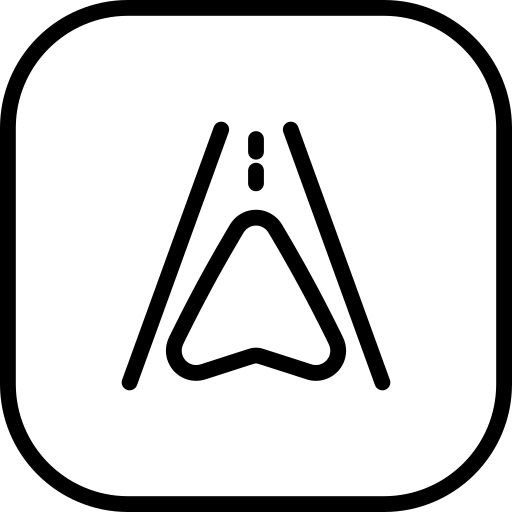

# Navigation

> **No longer developed.** Navigation 1.1 is the last version. All versions are kept here in History: [releases](RELEASES.md).

Offline maps and turn-by-turn navigation made for E Ink: one still picture per turn, black and white, and nothing running in the background unless you ask for it.

## What it can do

- Search, routes and voice guidance without internet, from maps you downloaded once.
- By car, on foot or by bicycle, with the distance and arrival time for each before you set off.
- One clear picture per turn: arrow, distance and street, with the roundabout exit and lane changes on motorway exits.
- Your speed, and the speed limit where OpenStreetMap knows it; a small black sign when you go over it.
- A black-and-white map with hatched parks and dotted water, drawn once when you lift your finger.
- Saved places (home, work, doctor, service, other); a long press on the map opens any place.
- Radio while driving: play, pause and next station of the Radio app, without leaving the drive.
- Maps for any country or region: find one by name or browse the list, then download it with a tap, only while the device is unlocked; your downloaded maps have a list of their own. A check for newer maps at most once a day.
- Everything that costs battery is off by default: guidance with the screen locked, the screen changing by itself and keeping the screen on are separate switches, only from Go to the end of the drive.

**Languages:** English, Croatian, German, French, Spanish, Italian, Portuguese, Dutch, Polish, Czech.

## Permissions

- **Internet:** to download maps and to check for newer ones.
- **Network state:** to check for a connection before a download.
- **Precise and approximate location:** your position on the map and guidance. Your location never leaves the device; see [PRIVACY.md](PRIVACY.md).
- **Extra location commands:** so the phone can refresh its satellite data (A-GPS), at most once every 16 hours and only with a network.
- **Foreground service, location service and notifications:** only with "Guidance while locked" switched on, from Go to the end of the drive.

## Install

Download the last APK, Navigation 1.1, from [this release](https://github.com/tintako-apps/history/releases/tag/navigation-v1.1) and install it on your device. Earlier versions are listed in [RELEASES.md](RELEASES.md).
